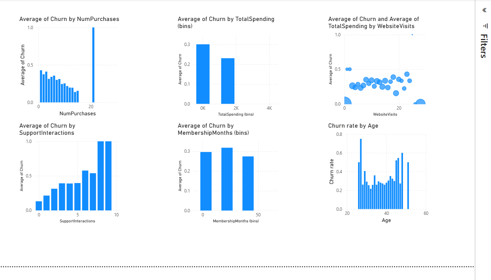
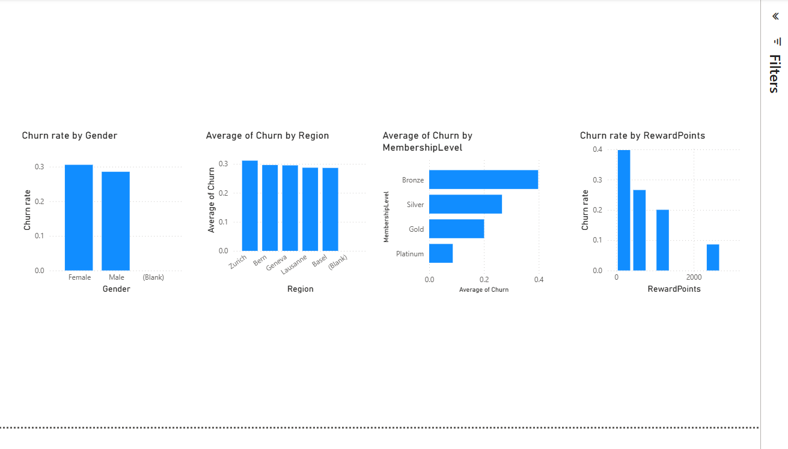

# End-to-End Customer Churn Analytics: Power BI & R

**Author:** Linka Ndizeye ([GitHub](https://github.com/linka257/)  
**Tech Stack:** Power BI, R (`caret`, `pROC`, `car`, `tidyverse`), Binary Logistic Regression  

---

## Business Problem
HomeShop, a mid-sized Swiss online electronics retailer, observed rising attrition among previously active buyers. Using a dataset of **24,017 customer records**, this two-phase project moves from **diagnostic exploration (Power BI)** to **predictive risk scoring (R)** to design targeted retention strategies.

---

## Phase 1: Diagnostic Analysis (Power BI)
Exploratory visual analysis across 10 behavioral, loyalty, and demographic variables revealed:
* **Loyalty Tier Gap:** Bronze members churned at **40%**, compared to **27%** (Silver), **20%** (Gold), and **9%** (Platinum).
* **Support Friction Spike:** Customers with 0–2 support tickets showed 13–31% churn, whereas churn escalated sharply at **6–8+ interactions**.
* **Non-Linear Age Effect:** Churn peaked among younger shoppers (23–29) and older shoppers (45–51), while ages 30–44 remained most stable.
* **Low Standalone Demographic Impact:** Gender (29% vs. 31%) and Swiss canton alone (29–31%) showed minimal variation.

### Diagnostic Dashboards

---

## Phase 2: Predictive Modeling (R)
Using an **80/20 train-test split**, a refined binary logistic regression model (`glm`) was trained on key behavioral and loyalty predictors (see `HomeShop_Churn_Model.R`):
* **Support Interactions (`OR = 1.33`):** Each additional support contact increases churn odds by **33.2%** ($p < 0.001$).
* **Membership Tier (`OR = 0.20` to `0.59`):** Platinum members are **80.2% less likely** to churn than Bronze members ($p < 0.001$).
* **Purchase Frequency (`OR = 0.92`):** Each additional order reduces churn odds by **8.1%** ($p < 0.001$).
* **Seasonality (`OR = 1.37`):** December shoppers face **36.6% higher** churn odds compared to the baseline month ($p < 0.001$).
* **Model Performance:** Achieved **70.7% accuracy**, **94.7% specificity**, and **0.684 AUC** on 4,797 unseen test records.

---

## Actionable Recommendations
1. **3-Ticket Escalation Trigger:** Deploy AI self-service support for routine queries and automatically route customers with **3+ support tickets** to a dedicated retention specialist.
2. **Tier-Upgrade Incentives:** Offer bonus points or trial Gold perks to active Bronze/Silver buyers to lock in retention benefits.
3. **Threshold Tuning for Campaigns:** Lower the classification probability cutoff from `0.50` to `~0.30` when running low-cost automated email retention campaigns to capture more at-risk shoppers.
